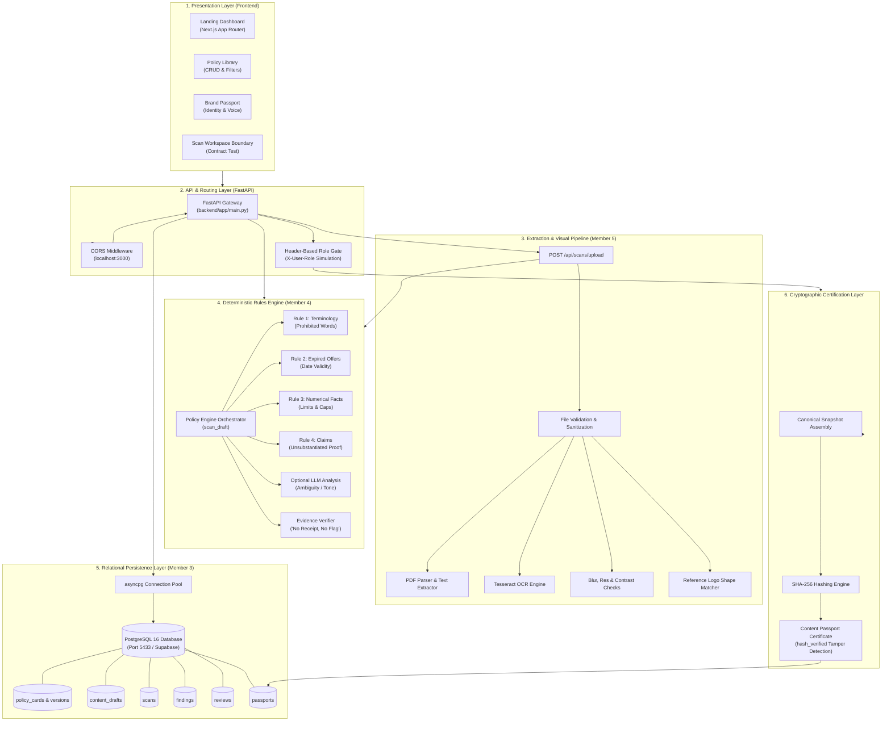
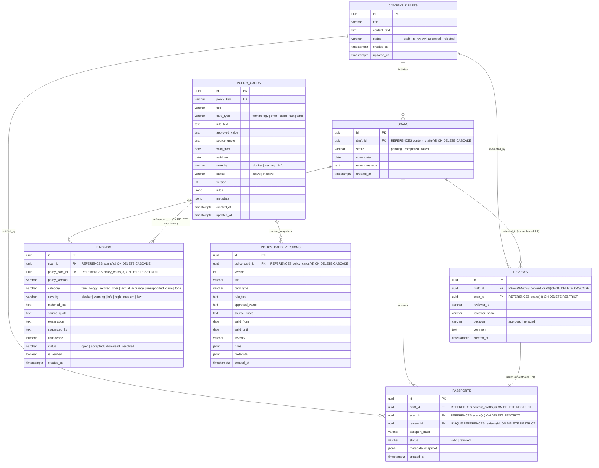
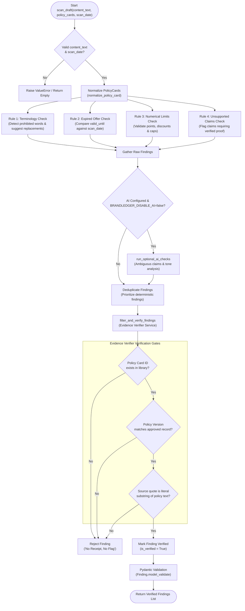
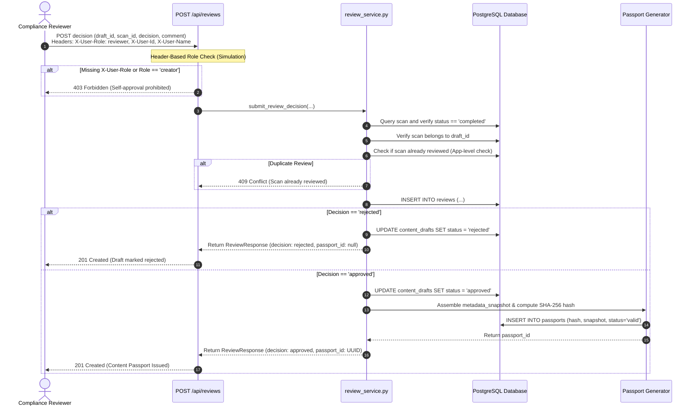
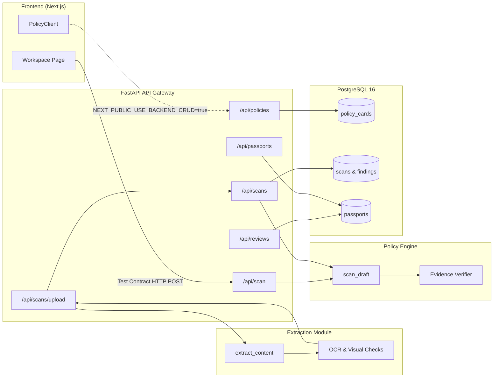

# BrandLedger — System Architecture & Technical Specification

**Author:** Umme Haany Tandur  
**Role:** QA, Integration, Testing & Submission Lead (Member 6)  
**Project:** BrandLedger Brand Governance & Deterministic Policy Compliance Platform  
**Target Submission:** Future Stack Hackathon  
**Document Version:** 1.1 (Refined Accuracy Review)  

---

## 1. Project Overview and Purpose

### 1.1 Problem Statement
Modern marketing and content publishing workflows increasingly rely on generative AI and distributed content teams. However, generative language models frequently hallucinate non-existent promotional offers, use outdated brand slogans, misquote numerical discounts, and fabricate compliance approvals. In regulated industries (finance, healthcare, retail), publishing unauthorized claims or expired terms leads to legal penalties, customer disputes, and brand erosion.

### 1.2 Core Value Proposition: "No Receipt, No Flag"
BrandLedger is a brand governance and pre-publication compliance platform. The foundational tenet governing the entire platform is:

> **"No receipt, no flag."**  
> *The deterministic rules engine and evidence verifier will NEVER report a violation, warning, or guideline mismatch without citing the exact Policy Card ID, the approved version number, and an exact verbatim quotation from the approved brand policy document.*

BrandLedger is designed to provide deterministic proof for every compliance finding. If a finding cannot produce an authentic, verbatim textual citation from the active brand policy library, the system suppresses the flag to prevent false-positive hallucinations.

### 1.3 Key User Personas
1. **Content Creators & Marketers (Member 1 Workflow):** Draft promotional text, social posts, banner copy, or upload creative assets (PDFs, images) to receive immediate compliance feedback before submission.
2. **Compliance Officers & Reviewers (Member 3 Workflow):** Inspect pre-publication scan results, verify cited policy evidence, and formally approve or reject content through a review gate.
3. **Brand Governance Leads (Member 2 Workflow):** Author, version, update, and archive living brand policies, maintain brand voice pillars, and inspect cryptographically verified Content Passports.

---

## 2. Overall System Architecture

BrandLedger is structured as a modular, six-layer architecture spanning frontend presentation, pre-processing, API orchestration, deterministic evaluation, relational persistence, and cryptographic verification.



---

## 3. Frontend Architecture and Main Pages

### 3.1 Technology Stack
- **Framework:** Next.js 16.4.3 with App Router and Turbopack
- **UI Library:** React 19.3.0
- **Language:** TypeScript 5.x
- **Styling:** Vanilla CSS Modules with custom design tokens (`globals.css`)
- **State & Data Client:** `PolicyClient` with client-side localStorage and REST adapter

### 3.2 Main Pages & Component Hierarchy

#### 1. Home Dashboard (`/` - `frontend/src/app/page.tsx`)
- Introduces BrandLedger governance, the "No receipt, no flag" tenet, and core modules.
- Displays an interactive architecture matrix crediting all six team member responsibilities.
- Direct navigation to the Policy Library and Brand Passport.

#### 2. Policy Library (`/policies` - `frontend/src/app/policies/page.tsx`)
- Authoritative management center for living brand policy cards.
- **Filtering & Search:** Real-time filtering by category (`terminology`, `offer_validity`, `numerical`, `claims`, `tone`, `visual`), status (`approved`, `draft`, `archived`), and keyword search.
- **Drawer Inspector:** Slide-out drawer (`PolicyDetailDrawer.tsx`) displaying structured rules, author metadata, effective dates, and verbatim source quotations.
- **Policy Authoring:** Modal form (`PolicyFormModal.tsx`) enforcing live quote verification before saving: prevents policy creation if the cited quote is not an exact substring of the policy text.

#### 3. Brand Passport (`/brand-passport` - `frontend/src/app/brand-passport/page.tsx`)
- Executive summary of brand identity guidelines.
- **Governance Score:** Displays a compliance rating (e.g., 98/100) and mission statement.
- **Voice & Tone:** Explicit Dos and Don'ts pillars (`VoiceToneSection.tsx`).
- **Brand Guardrails:** Numerical thresholds, pricing caps, and claim rules (`GuardrailsSection.tsx`).
- **Visual Asset Guidelines:** Logo clear space, primary/secondary brand colors, typography rules (`VisualAssetsSection.tsx`).
- **Terminology Comparison Table:** Approved vs. prohibited vocabulary (`TerminologySection.tsx`).
- **Export:** One-click JSON export of the complete brand passport profile.

#### 4. Scan Workspace Integration Boundary (`/workspace` - `frontend/src/app/workspace/page.tsx`)
- Demonstrates integration between Member 1 (Sana's scan workspace), Member 2 (Nimra's policy export contract), and Member 4 (Zynab's scan engine).
- Formulates a test payload using `policyClient.getApprovedPoliciesForScan()` and tests HTTP `POST /api/scan`.

### 3.3 Data Layer & Persistence Adapter (`policyClient.ts`)
The frontend uses a dual-mode persistence architecture:
1. **Development Adapter (Active by default):** Reads and writes to browser `localStorage` with fallback to in-memory seed records (`INITIAL_POLICY_CARDS`, `INITIAL_BRAND_PROFILES` from `mockData.ts`).
2. **Live Backend Mode (`NEXT_PUBLIC_USE_BACKEND_CRUD=true`):** Communicates directly with the FastAPI backend endpoint `GET /api/policies`.
3. *Implementation Boundary Note:* The mock adapter serves UI-specific shapes (e.g., `rules: AnyRule[]`, `category: PolicyCategory`), whereas the backend returns PostgreSQL-mapped entity shapes (`card_type`, `rule_text`). In development, the client relies on the internal adapter.

---

## 4. Backend Architecture and API Responsibilities

### 4.1 Framework & Core Engine
- **Framework:** FastAPI (Python 3.11+ / 3.13)
- **Database Driver:** `asyncpg` with managed connection pool
- **Configuration:** `pydantic-settings` reading from `.env`
- **Validation:** Pydantic v2 schemas (`backend/app/schemas/`)

### 4.2 Endpoint Catalog

| Method | Endpoint | Router File | Primary Responsibility |
|---|---|---|---|
| `GET` | `/health` | `main.py` | Service liveness probe (`status: ok`, `service: brandledger-api`). |
| `POST` | `/api/scan` | `main.py` | Direct in-memory draft scan. Receives text and policy cards; returns validated findings without database persistence. |
| `GET` | `/api/policies` | `api/policies.py` | Query active or filtered policy cards from PostgreSQL with optional category filtering. |
| `POST` | `/api/policies` | `api/policies.py` | Create a new policy card and automatically record version 1 in `policy_card_versions`. |
| `PATCH` | `/api/policies/{id}` | `api/policies.py` | Update policy fields. If rule content changes, automatically bumps version and archives snapshot in `policy_card_versions`. |
| `POST` | `/api/scans` | `api/scans.py` | Full scan workflow: persists draft, loads active policies, executes rules engine, and persists findings to DB. |
| `GET` | `/api/scans/{id}` | `api/scans.py` | Retrieve scan execution status, draft reference, and all persisted findings. |
| `POST` | `/api/scans/upload` | `api/uploads.py` | Multipart file upload (image, PDF, TXT), runs OCR/visual extraction, then passes text into `execute_scan`. |
| `POST` | `/api/reviews` | `api/reviews.py` | Review decision gate. Evaluates header-based role, updates draft status, and generates Content Passport on approval. |
| `GET` | `/api/passports/{id}`| `api/passports.py` | Retrieve Content Passport certificate and compute SHA-256 canonical hash on-the-fly for tamper detection. |

---

## 5. Database Structure and Relational Schema

The relational database is implemented in PostgreSQL 16 (`database/schema.sql`). It enforces referential integrity, constraints, and audit preservation across six core entities and version snapshots.



### Verified Relational Details & Constraint Boundaries
1. **Policy Version Tracking (`policy_card_versions`):**
   - Implements application-level version snapshots with a database composite unique constraint: `UNIQUE (policy_card_id, version)`.
   - When a policy's core content changes, `PATCH /api/policies/{id}` increments the version integer and writes a new row to `policy_card_versions`.
   - *Constraint Note:* The foreign key has `ON DELETE CASCADE`. If a policy card row is deleted from `policy_cards`, its historical versions in `policy_card_versions` are also deleted by PostgreSQL cascade.
2. **Finding Version Reference:**
   - `findings.policy_card_id` references `policy_cards(id)` with `ON DELETE SET NULL`.
   - `findings.policy_version` stores the version string (e.g., `"1.0"`, `"2"`). It does **not** have a foreign key pointing directly to `policy_card_versions(id)`. Traceability is maintained through the combination of `policy_card_id` and the recorded `policy_version` string.
3. **Review Multiplicity Check:**
   - In `schema.sql`, `reviews.scan_id` has `REFERENCES scans(id) ON DELETE RESTRICT`, but does **not** have a `UNIQUE` constraint in the table definition.
   - The prevention of duplicate reviews is enforced at the **application service layer** (`review_service.py:81-89`), which executes `SELECT id, decision FROM reviews WHERE scan_id = $1` and raises an HTTP 409 Conflict if an existing review is found.
4. **Passport Multiplicity:**
   - `passports.review_id` has a database-level `UNIQUE` constraint (`UNIQUE REFERENCES reviews(id)`). A review decision can generate at most one Content Passport.

---

## 6. File Upload, Extraction, OCR, and Visual-Check Workflow

The extraction module (`backend/extraction_module/`, owned by Member 5) allows BrandLedger to audit uploaded marketing creative assets (PDF flyers, promotional PNGs, banners) using the same scan engine as raw text.

```mermaid
sequenceDiagram
    autonumber
    actor User as Marketer / User
    participant UploadAPI as POST /api/scans/upload
    participant FileProc as file_processing.py
    participant OCR as ocr_service.py (Tesseract)
    participant Visual as image_checks.py
    participant Logo as logo_matcher.py
    participant ScanSvc as execute_scan (scan_service.py)

    User->>UploadAPI: Upload multipart/form-data (File, Title, Scan Date)
    UploadAPI->>FileProc: Validate file type & size (<= BL_MAX_FILE_MB)
    
    alt Unsupported Format or Corrupt File
        FileProc-->>UploadAPI: Raise HTTP 422 (UNSUPPORTED_FORMAT / CORRUPT_FILE)
        UploadAPI-->>User: Return error (No scan created)
    end

    alt PDF Input
        FileProc->>FileProc: Render pages at 200 DPI via PyMuPDF
        alt Selectable Text Layer (chars >= 30)
            FileProc->>FileProc: Extract embedded text layer
        else Scanned / Raster PDF Page
            FileProc->>OCR: Run Tesseract OCR on rendered page
        end
    else Image Input (PNG, JPG, WEBP, TIFF)
        FileProc->>OCR: Run Tesseract OCR with image preprocessing
    end

    FileProc->>Visual: Check resolution (>=400x800px) & blur (Laplacian variance >=60)
    FileProc->>Visual: Estimate text contrast ratio from word boxes
    FileProc->>Logo: Compare image against approved/deprecated logos

    alt No text extracted from file
        FileProc-->>UploadAPI: extracted_text is empty
        UploadAPI-->>User: Raise HTTP 422 ("Could not read file; requires human review")
    else Text extracted successfully
        UploadAPI->>ScanSvc: execute_scan(title, extracted_text, scan_date)
        ScanSvc-->>UploadAPI: Return persisted ScanResponse & Findings
        UploadAPI-->>User: Return UploadScanResponse (Scan + Extraction Summary)
    end
```

### Safety Principles in Extraction
- **No Silent Passes:** If a file is unreadable or produces no text, BrandLedger does **not** report "no violations found". It fails with an explicit error stating that human review is required.
- **Contrast Disclaimer:** Contrast calculations are estimates derived from OCR word bounding boxes. The system explicitly declares `wcag_verified: false` to avoid false compliance claims.
- **Logo Similarity Disclaimer:** Logo matching results are similarity scores, not definitive legal clearances. Any match or mismatch triggers `human_review_required: true`.

---

## 7. Policy Scanning and Evidence Verification Workflow

The core compliance engine (`backend/app/services/policy_engine.py`, owned by Member 4) evaluates text against normalized policy cards.



### Deterministic Rule Check Details
1. **Terminology (`check_terminology`):** Uses regex word-boundary matching to catch prohibited terms (e.g. `"Customers"`) and suggests mandatory replacements (`"Members"`).
2. **Expired Offers (`check_expired_offers`):** Compares promotion names and validity dates against the reference `scan_date`. If a draft mentions `"Summer Discount"` and the scan date is `2026-07-01` (expired `2026-06-30`), an expired offer blocker is generated.
3. **Numerical Facts (`check_factual_accuracy`):** Extracts numerical quantities (e.g. `"800 points"`) and verifies them against maximum or exact limits defined in the policy (e.g. maximum 500 bonus points).
4. **Unsupported Claims (`check_unsupported_claims`):** Detects superlative or absolute assertions (e.g. `"India's No. 1"`) and flags them as requiring certified documentation.

---

## 8. Review and Approval Workflow

Content cannot be published or certified based on automated scanning alone. BrandLedger implements a **Human-in-the-Loop Review Gate** (`backend/app/api/reviews.py`).



### 8.1 Header-Based Role Authorization Mechanism & Limitations
Reviewer authorization in BrandLedger is implemented via HTTP request headers (`backend/app/api/reviews.py`):
- `X-User-Role`: Required header. Accepts `'reviewer'` or `'admin'`.
- If `X-User-Role` is missing or has the value `'creator'`, the API responds with HTTP 403 Forbidden to prevent creator self-approval.
- `X-User-Id` and `X-User-Name`: Optional headers providing reviewer identity for audit logging.

**Implementation Scope & Limitations:**
- This header-based check is an application-level simulation designed for hackathon demonstration and workflow testing.
- It does **not** constitute production-grade authentication or secure Role-Based Access Control (RBAC). It does not validate cryptographic signatures, JSON Web Tokens (JWTs), or user sessions. Any client can supply the `X-User-Role: reviewer` header unless a secure reverse proxy or authentication gateway is placed in front of the API.

---

## 9. Brand Passport Generation and Verification

### 9.1 Canonical Snapshot Construction
When an authorized reviewer approves content, BrandLedger creates a cryptographic snapshot stored in PostgreSQL containing:
- `draft_id`, `draft_title`, `draft_content`
- `scan_id`, `review_id`, `reviewer_id`, `reviewer_name`
- `decision` (`"approved"`), `comment`, `issued_at`
- `policy_versions_applied`: sorted list of every policy ID and version applied
- `findings_summary`: exact categories, severities, matched text, and cited quotes
- `total_findings`

### 9.2 Deterministic SHA-256 Hash Computation
To prevent hashing differences caused by JSON key ordering or whitespace discrepancies, BrandLedger uses a canonical serialization:
```python
def compute_canonical_passport_hash(snapshot: Dict[str, Any]) -> str:
    canonical_json = json.dumps(
        snapshot,
        sort_keys=True,
        separators=(",", ":"),
        ensure_ascii=True,
    )
    return hashlib.sha256(canonical_json.encode("utf-8")).hexdigest()
```

### 9.3 Tamper Detection Scope and Limitation (`GET /api/passports/{id}`)
Whenever a Content Passport is retrieved:
1. The server loads the stored `metadata_snapshot` JSON and stored `passport_hash`.
2. It re-computes the canonical SHA-256 hash across the loaded snapshot.
3. It sets `hash_verified = (computed_hash == stored_hash)`.

**Important Security Clarification:**
- The SHA-256 hash provides **tamper detection**, not **write prevention**.
- If a user or process with database write access modifies the `metadata_snapshot` column in PostgreSQL, the next retrieval will compute a different hash and report `hash_verified = False`, exposing the modification.
- However, the hash verification does not by itself write-protect the PostgreSQL table or prevent unauthorized updates if the database credentials are compromised or if someone also recalculates and overwrites `passport_hash` in the database.

---

## 10. Inter-Module Communication and Integration Boundaries



```

### Resolved Integration Gaps & Boundaries
1. **Frontend Client Integration & Bidirectional Schema Mapping (Resolved by Member 2):**
   - The frontend `policyClient.ts` provides robust bidirectional translation between backend entity shapes (`card_type`, `rule_text`, `status='active'/'inactive'`) and frontend models (`category`, `content`, `status='approved'/'archived'`).
   - Handles both wrapped API envelopes `{ "items": [...], "total": ... }` and raw arrays.
   - Includes real-time server error alerts with a prominent retry button and avoids false-success localStorage writes upon backend failures.
2. **Scan Workspace Ownership Boundary:**
   - The interactive marketer editor and finding highlighter belong to Member 1 (Sana). The `/workspace` route acts as an integration boundary verifying the contract between Member 2 policy cards and Member 4 scan engine.
3. **Direct Scan vs. Database Scan:**
   - `POST /api/scan`: Stateless, takes policy cards in payload, returns findings (used for client-side policy preview).
   - `POST /api/scans`: Stateful, persists draft and findings in PostgreSQL, prerequisites for review and Content Passport issuance.

---

## 10. Member 2 Technical Specification: Policy Library, Brand Passport, and Authoritative Agent Tools

**Lead Engineer:** Nimra (Member 2)  
**Modules:** `backend/app/api/policies.py`, `backend/app/schemas/policy.py`, `backend/app/api/agent_tools.py`, `backend/app/services/policy_agent_tools.py`, `frontend/src/lib/api/policyClient.ts`, `frontend/src/app/policies/page.tsx`

### 10.1 Conceptual Separation: Brand Passport vs. Content Passport

A core architectural principle in BrandLedger is the distinct boundary between the brand's identity guidelines and individual creative proof certificates:

| Dimension | Brand Passport (`/brand-passport`) | Content Passport (`/passports`) |
| :--- | :--- | :--- |
| **Owner** | Member 2 (Nimra) | Member 3 (Zoya) & Member 2 Verification |
| **Domain** | Brand Identity, Voice Pillars, Color Palette, Tone, Governance Score | Cryptographic digital audit proof issued for an approved creative submission |
| **Mutability** | Living brand guidelines updated by brand governance leads | Strictly immutable snapshot created upon reviewer approval |
| **Integrity Mechanism** | Relational versioning (`policy_card_versions`) | SHA-256 canonical snapshot hash & Merkle inclusion proof |
| **Consumption** | Human marketers, brand teams, AI generation prompts | Fetch.ai agent publish gates, downstream social publishers, ad networks |

### 10.2 Policy Lifecycle and Immutable Version History

To enforce auditability and eliminate retroactive compliance disputes, policy cards utilize dual-table temporal versioning:

1. **`policy_cards` Table (Current State):** Contains current active or inactive policy cards with stable identifiers:
   - `id`: Immutable UUID primary key.
   - `policy_key`: Stable human-readable identifier (e.g. `pol_term_001`, `pol_offer_002`).
   - `version`: Integer tracking the latest version number.
   - `status`: `active` or `inactive` (soft-archived without deleting historical snapshots).
2. **`policy_card_versions` Table (Immutable History):** Whenever `rule_text`, `source_quote`, `approved_value`, `rules`, or `severity` changes:
   - The version counter is incremented.
   - An exact, unalterable snapshot is recorded with `(policy_card_id, version)`.
   - Historical lookups via `GET /api/policies/{policy_id}?version=X` and `GET /api/tools/policies/{policy_id}?version=X` query this table. If a requested version does not exist, the API returns **404 Not Found** and strictly refuses to fall back to the latest version.

### 10.3 Authoritative Agent Tools (Member 2 Implementation)

Member 2 provides five deterministic, machine-readable agent tools accessible via Python imports (`backend.app.services.policy_agent_tools` / `backend.app.services.agent_tools`) and REST endpoints under `/api/tools/`:

```
┌─────────────────────────────────────────────────────────────────────────────┐
│                           Agent Tools Gateway                               │
│                         (/api/tools/* + AGENT_API_KEY)                      │
└──────┬──────────────────────┬──────────────────────┬─────────────────┬──────┘
       │                      │                      │                 │
       ▼                      ▼                      ▼                 ▼
 1. get_approved_      2. get_policy_         3. get_passport   4. verify_passport  5. explain_finding
    policies              details                (/passports/      (/passports/        (/findings/
    (/policies)           (/policies/{id})        {id})             verify)             explain)
       │                      │                      │                 │                   │
       ▼                      ▼                      ▼                 ▼                   ▼
 Active policies only;  UUID / policy_key;     Fetch certificate; Recompute canonical  Verbatim quote match
 Drafts & archived      ?version=X history;    frozen snapshot;   SHA-256 hash vs      ("No receipt, no
 strictly excluded      404 if missing         applied policies   stored hash          flag"); remediation
```

1. **`get_approved_policies(card_type: Optional[str])` (`GET /api/tools/policies`):**
   - Returns ONLY active/approved policies.
   - Excludes draft, inactive, and archived cards.
   - Preserves stable UUIDs, `policy_key`, structured `rules`, and verbatim `source_quote`.
2. **`get_policy_details(policy_id: str, version: Optional[str])` (`GET /api/tools/policies/{policy_id}`):**
   - Retrieves full policy details by UUID or `policy_key`.
   - Supports `?version=X` for immutable historical retrieval from `policy_card_versions`.
   - Strictly returns 404 if version does not exist.
3. **`get_passport(passport_id: str)` (`GET /api/tools/passports/{passport_id}`):**
   - Retrieves Content Passport digital certificate.
   - Returns `passport_hash`, `status`, `metadata_snapshot`, `applied_policy_versions`, and `hash_verified`.
4. **`verify_passport(passport_id, passport_hash, metadata_snapshot)` (`POST /api/tools/passports/verify`):**
   - Computes deterministic SHA-256 hash across canonically sorted snapshot JSON (`sort_keys=True`, compact separators).
   - Returns machine-readable verdict: `status: "VALID"` (`hash_verified: true`), `status: "TAMPERED"` (`hash_verified: false`), or `status: "NOT_FOUND"`.
5. **`explain_finding(finding_id, scan_id, finding_index, finding)` (`POST /api/tools/findings/explain`):**
   - Enforces "No receipt, no flag": Resolves cited policy card and exact version.
   - Verifies that `source_quote` exists verbatim in the approved policy text.
   - If verified: sets `evidence_provenance: "VERIFIED"`, `is_verified: true`, and provides actionable remediation guidance.
   - If unverified or fabricated: sets `evidence_provenance: "UNVERIFIED"`, `is_verified: false`, and marks as `HUMAN_REVIEW_REQUIRED`.

### 10.4 Agent Authentication Security

All `/api/tools/*` endpoints are protected by an authoritative agent authentication dependency (`verify_agent_auth`):
- Checks for `AGENT_API_KEY` configured in the environment.
- Accepts credentials via `Authorization: Bearer <token>` or `X-Agent-Key: <token>`.
- Performs constant-time token verification using `secrets.compare_digest` to prevent timing attacks.
- Rejects unauthorized or missing credentials with **401 Unauthorized**.
- Operates in permissive mode during local offline development when `AGENT_API_KEY` is not set.

### 10.5 Dual-Mode Architecture & Offline Resilience

All Member 2 services and endpoints operate in a robust dual-mode architecture:
- **Live PostgreSQL Mode:** When `db_manager.pool` is connected, all operations execute authoritative SQL transactions against `policy_cards`, `policy_card_versions`, and `passports`.
- **Resilient Mock Mode:** When PostgreSQL or Docker is offline (e.g. during CI or client tests), the system transparently utilizes an in-memory storage layer seeded with authentic `seed.sql` records, ensuring 100% test suite determinism and offline developer experience without compromising production SQL code paths.

---

## 11. Environment Configuration and High-Level Execution Guide

### 11.1 Prerequisites
- **Python:** 3.11 or higher
- **Node.js:** v18 or higher (v24 tested)
- **Docker & Docker Compose:** for PostgreSQL 16
- **Tesseract OCR:** installed via package manager (`brew install tesseract` on macOS)

### 11.2 High-Level Startup Sequence

#### 1. Start Database Container
```bash
# Starts PostgreSQL 16 on port 5433 with schema.sql and seed.sql automatically executed
docker compose up -d
```

#### 2. Configure Environment Variables
```bash
# Copy template configuration
cp .env.example .env
```

#### 3. Run Backend API Server
```bash
# Activate virtual environment and install dependencies
source .venv/bin/activate
pip install -r requirements.txt

# Run FastAPI with live reload on port 8000
uvicorn backend.app.main:app --reload --host 0.0.0.0 --port 8000
```
- Verify health: `curl http://127.0.0.1:8000/health` $\rightarrow$ `{"status":"ok","service":"brandledger-api"}`
- Interactive OpenAPI Docs: `http://127.0.0.1:8000/docs`

#### 4. Run Frontend Development Server
```bash
cd frontend
npm install
npm run dev
```
- Open browser: `http://localhost:3000`
- Access Policy Library: `http://localhost:3000/policies`
- Access Brand Passport: `http://localhost:3000/brand-passport`
- Access Integration Workspace: `http://localhost:3000/workspace`

---

## 12. Verification & Traceability Sign-off

This architectural specification reflects the actual codebase implementation across branches and merged feature sets as of commit `9ed2261`. No hypothetical or unverified features were added.

*Document prepared by Umme Haany Tandur (QA, Integration, Testing & Submission Lead).*
